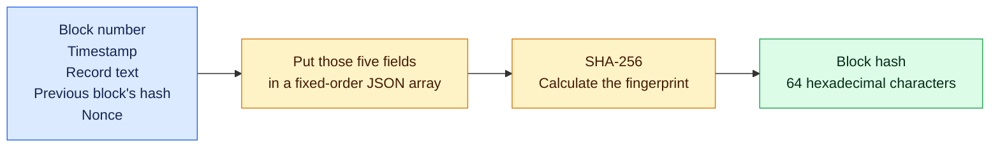
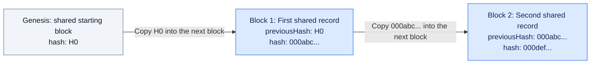
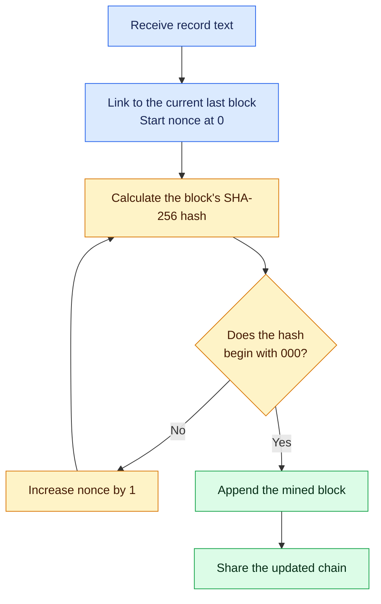
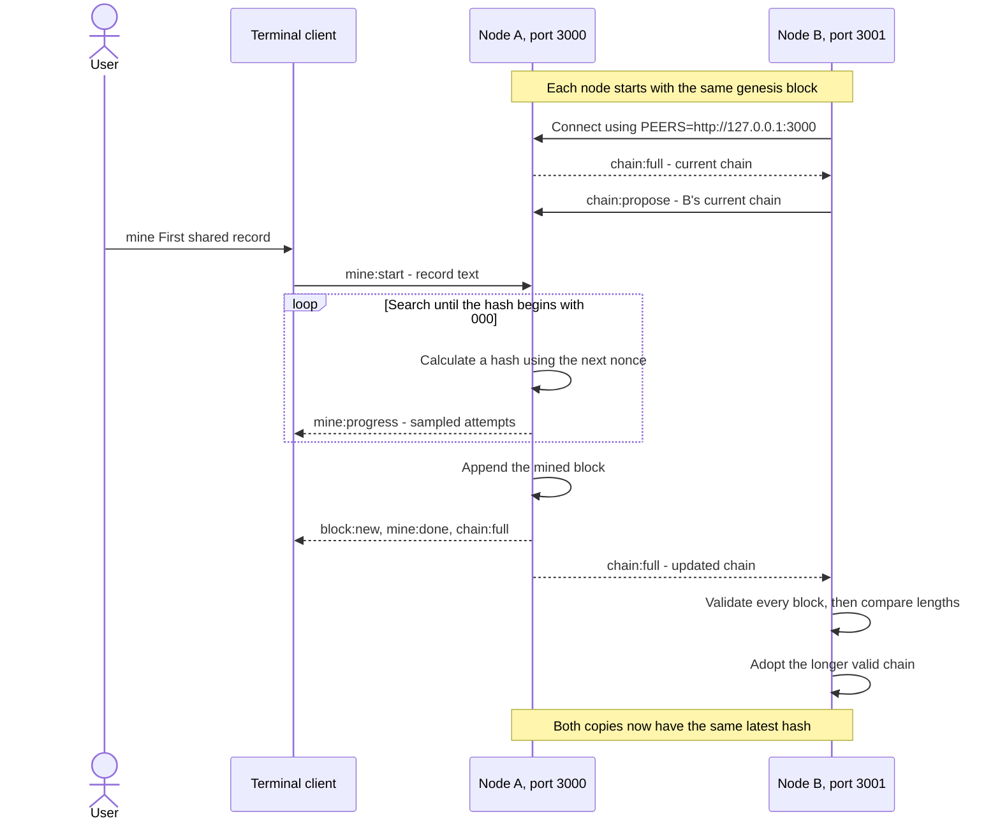
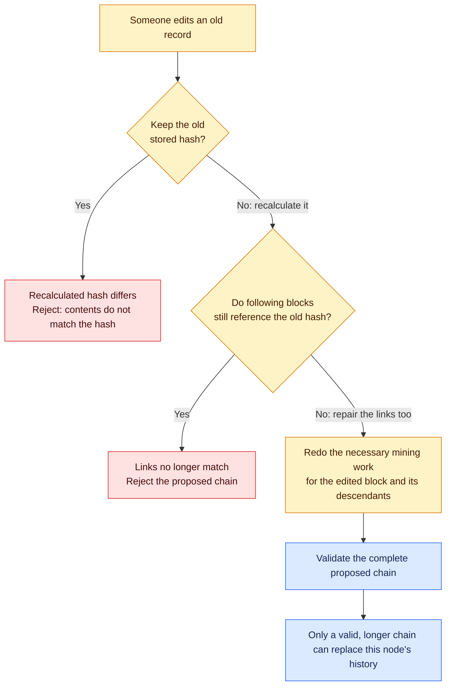
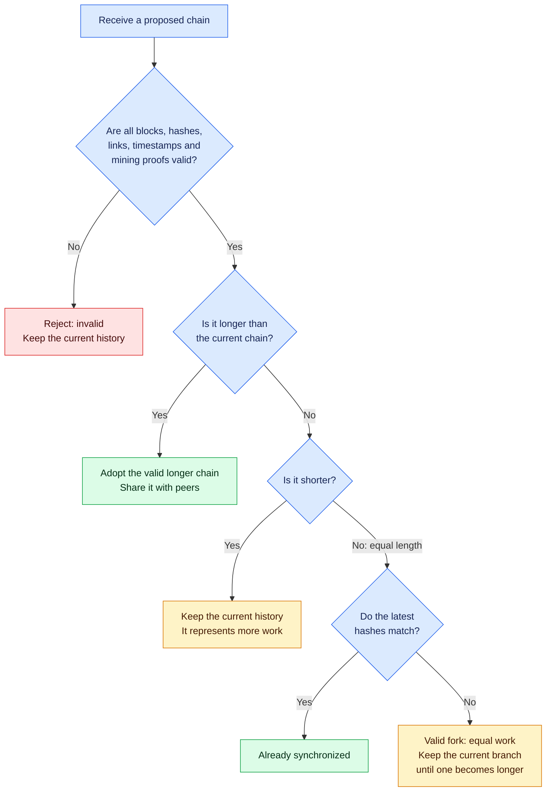
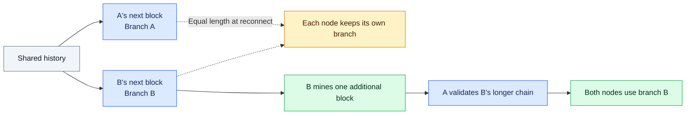

# Blockchain and mining: code and visualizer guide

This project implements a blockchain backend and a terminal client. A blockchain visualizer can display its records and links. A mining visualizer can display the nonce search and hash attempts. Both can connect to the existing socket API.

This guide explains the concepts, connects them to the source code, and shows how to integrate those two visualizers. Hashes shown with `...` in diagrams are shortened, illustrative examples.

## Start a node

From the project folder, with Node.js 20 or later:

```bash
npm install
npm start
```

Leave that terminal running. The node listens at `http://127.0.0.1:3000`. Open `http://127.0.0.1:3000/api/chain` to inspect its JSON state, or connect a visualizer using the [browser example below](#8-connect-the-visualizers).

`npm run demo` runs four automated scenarios and exits. `npm test` runs the test suite. For an interactive session, use a running node with the terminal client or a connected visualizer.

## The concepts

A blockchain is an ordered history of records grouped into blocks. Each block contains a fingerprint of the previous block, so the records are linked. A node is a running participant that keeps its own copy of that history and checks proposed updates.

Mining is the search for a block fingerprint that meets an agreed requirement. The miner repeatedly changes a number called the nonce and calculates a new hash. The qualifying hash and nonce provide proof of work that other nodes can verify.

| Term | Meaning in this project |
| --- | --- |
| Block | One text record with its index, timestamp, links and mining result |
| Hash | A SHA-256 fingerprint calculated from a block's fields |
| Nonce | A number changed on each mining attempt |
| Difficulty | The number of leading hexadecimal zeroes required in a mined hash; fixed at `3` |
| Genesis | The shared first block, at index `0` |
| Node | A server process with its own blockchain in memory |
| Peer | Another node this node connects to and exchanges chains with |
| Fork | Different valid branches growing from a shared history |
| Consensus | The rules each node uses to choose which valid history to keep |

## Where the code lives

| Source | Responsibility |
| --- | --- |
| [`src/client.js`](../src/client.js) | Reads terminal commands, emits socket requests, and displays replies |
| [`hashBlock`](../src/server.js#L16) | Serializes the block fields and calculates SHA-256 |
| [`Blockchain.mine`](../src/server.js#L50) | Searches nonces, reports progress, and appends a mined block |
| [`validate`](../src/server.js#L167) | Checks the structure, fingerprints, links, timestamps and proof of work of a whole chain |
| [`Blockchain.replace`](../src/server.js#L121) | Validates a proposed chain, then decides whether to adopt it |
| [`Blockchain.toJSON`](../src/server.js#L156) | Returns a copied snapshot for clients and peers |
| [`startNode`](../src/server.js#L242) | Starts HTTP and Socket.IO servers and connects peers |
| [`demo.js`](../demo.js) | Exercises synchronization, forged chains and fork resolution with temporary nodes |

For the command `mine hello`, follow [`client.js`](../src/client.js#L57) emitting `mine:start`, then the [`server.js` handler](../src/server.js#L322) calling `blockchain.mine`. The handler broadcasts progress, completion and the updated chain. A visualizer uses the same events as that terminal client.

## 1. A hash is a block's fingerprint

The same inputs always produce the same fingerprint. The block stores the result so another participant can calculate it again and check that it matches. Editing a record while keeping its original hash causes that check to fail.



[`hashBlock`](../src/server.js#L16) hashes exactly this representation:

```js
JSON.stringify([
  block.index,
  block.timestamp,
  block.data,
  block.previousHash,
  block.nonce,
]);
```

SHA-256 is applied to that string and returned as lowercase hexadecimal. Field order, types and serialization matter if a visualizer reproduces the calculation. The `hash` field itself is excluded from its own calculation.

## 2. The fingerprints connect the history

Each new block contains the previous block's hash. The arrows show the order of the records; the labels show which fingerprint the next block stores.



The genesis block is identical on every node and is exempt from mining. Every later block must satisfy the mining requirement.

The block object has six fields:

| Field | Purpose |
| --- | --- |
| `index` | Position in the chain, starting at `0` for genesis |
| `timestamp` | Integer time in milliseconds; it must be at least the parent's timestamp |
| `data` | The text record being stored |
| `previousHash` | The previous block's fingerprint; genesis uses the string `"0"` |
| `nonce` | Nonnegative integer found during mining |
| `hash` | The calculated 64-character SHA-256 fingerprint |

This complete example is a valid block following this project's genesis. Its fixed timestamp makes the calculation reproducible:

```json
{
  "index": 1,
  "timestamp": 1700000000000,
  "data": "First shared record",
  "previousHash": "499aa71614a65a910615cae104028d405487e3eb5f06fadd6027bb9fcc5ed3bc",
  "nonce": 4971,
  "hash": "000b070c30b547573c895b682eb9d4a537f73b2b7d739fc5b9324adae1201846"
}
```

Starting at nonce `0`, that record took `4,972` attempts. Live mining uses the current time, so entering the same text later can produce a different nonce and hash.

## 3. Mining searches for a qualifying fingerprint

The nonce is a number the miner can change. At difficulty **3**, a mined hash must begin with **`000`**. Each attempt recalculates the entire hash with a different nonce.



There are 16 hexadecimal digits, so three leading zeroes take about **16 x 16 x 16 = 4,096 attempts on average**. The actual number varies. Another participant can verify the winning hash with one calculation.

[`Blockchain.mine`](../src/server.js#L50) implements the loop:

1. Reject a second active mining job, invalid text, a full chain, or an invalid current chain.
2. Capture the current last block as the parent. Set the new index, timestamp, text and `previousHash`; start the nonce at `0`.
3. Calculate `hashBlock(newBlock)`. The attempt count is `nonce + 1`.
4. If the hash starts with `000`, finish the search. Otherwise, increase the nonce and try again.
5. Every 1,000 failed attempts, yield to the event loop so the server can receive other messages.
6. If another chain changes the parent while mining, discard the stale work and return an error. The requester can retry on the updated chain.
7. Append the completed block and release the mining lock. The socket handler then broadcasts completion and the updated chain.

The progress callback runs on the first attempt, every 1,000 attempts, and the winning attempt. A mining visualizer receives sampled hashes rather than every calculation. Display those reported attempts directly; there is no known final attempt count from which to calculate a percentage complete.

## 4. Two independent nodes synchronize

`127.0.0.1` means this computer. Ports `3000` and `3001` let two independent node processes run on the same laptop. Node B's `PEERS` setting tells it to connect to A. That socket connection carries messages in both directions.



Either node can mine. On reconnect, B offers its current chain again, including any blocks mined while disconnected. Progress events are available for visualizers; the terminal client displays chain summaries and mining completion, with full block details available through `view`.

[`connectPeer`](../src/server.js#L283) creates an outgoing Socket.IO connection. When A mines, B receives A's `chain:full`. When B mines, B sends a `chain:propose` to A. Both paths run the same validation and replacement rules.

## 5. Changing an old record leaves evidence

Validation recalculates each hash, checks the links and timestamps, and verifies proof of work. A proposal must pass all checks before its length matters.



A fully re-mined alternative history can be accepted if it is valid and longer. The rules establish consistency and work; they cannot establish whether arbitrary record text is true or authorize a payment.

[`validate`](../src/server.js#L167) also checks the six block fields, sequential indexes, text size, integer timestamps and nonces, hash formatting, and the exact genesis block. An invalid proposal returns an error and, where available, the index of the block that failed.

## 6. Validation comes before choosing a history

Difficulty is fixed across the network, so a longer valid chain represents more work. A chain with more blocks still has to pass every validation check.



[`Blockchain.replace`](../src/server.js#L121) returns `{ accepted, reason, message, blockIndex? }`. The `reason` is `invalid`, `shorter`, `unchanged`, `tie`, or `longer`. Only `longer` is accepted. A candidate cannot lower the network's difficulty by supplying a different `difficulty` field.

## 7. A fork resolves when one valid branch grows

Two participants can mine different valid blocks while disconnected. When they reconnect with equal-length histories, each keeps its branch. In the automated demo, B then mines one more block and A adopts B's longer valid branch.



[`demo.js`](../demo.js) reproduces the fork by calling `peerConnection.disconnect()`, mining on each node, and calling `peerConnection.connect()` before extending B's branch. A fork display needs separate snapshots from both nodes to show their different tips.

## 8. Connect the visualizers

The server runs the algorithm. Each visualizer is another Socket.IO client. It sends requests and renders the server's responses. Use a Socket.IO v4 client, which handles the connection protocol and event messages.

### Blockchain visualizer

Use `chain:full` as the complete current state. Render one card for each block in `state.blocks`, and connect adjacent cards using their hashes. The chain height is `state.blocks.length - 1` because genesis is included.

Replace the displayed state when a new snapshot arrives. A longer competing branch can replace earlier blocks, so updating the display by appending cards alone would leave the wrong history on screen. A peer that adopts a chain broadcasts `chain:full`; it does not emit local mining events for those received blocks.

### Mining visualizer

Send `mine:start` with `{ data: "your record" }`. Display each `mine:progress` payload's `nonce`, `hash`, `attempts`, `index` and `difficulty`. Highlight the hash prefix to show whether it meets the target.

`mine:done` contains the final block, attempt count and elapsed milliseconds. `mine:error` reports failure to the requester. Wait for completion and the authoritative chain snapshot before treating a sampled qualifying hash as a committed block: the chain can change during mining.

Mining can finish quickly at difficulty `3`. An animation can replay or slow down the received samples while identifying them as recorded attempts. There is no socket setting to increase the difficulty or slow the backend down.

### Event reference

| Direction | Event | Payload or response |
| --- | --- | --- |
| Client to node | `chain:get` | Send `{}`; receive the full state by callback and `chain:full` |
| Client to node | `mine:start` | Send `{ data }`; callback returns `{ ok: true, block, attempts, elapsedMs }` or `{ ok: false, message }` |
| Client to node | `chain:propose` | Send `{ blocks }`; callback returns the chain decision |
| Node to client | `chain:full` | `{ difficulty, blocks, validation, mining }` |
| Node to client | `mine:progress` | `{ index, difficulty, nonce, hash, attempts }` |
| Node to client | `block:new` | `{ block }` for a block mined on this node |
| Node to client | `mine:done` | `{ block, attempts, elapsedMs }` for mining on this node |
| Node to requester | `mine:error` | `{ message }` |
| Node to proposer | `chain:result` | `{ accepted, reason, message, blockIndex? }` |

Register handlers before connecting. Register them once, outside the `connect` handler, so reconnecting does not create duplicate listeners. The server sends `chain:full` on every connection, allowing the display to recover its current state after a disconnect.

Progress and completion events are broadcast to clients attached to the node doing the mining. To compare nodes, create one client connection per node. To display a mining error to observers other than the requester, the frontend needs to relay that request's error within its own UI.

`state.mining` describes the node when the snapshot was taken. The server does not broadcast a separate mining-start event; use the local request and incoming progress to update the mining indicator, or request a fresh snapshot with `chain:get`.

### Browser connection example

With `npm start` running, this HTML connects to node A and logs real events in the browser console. The server serves the client library at `/socket.io/socket.io.js`. For an existing frontend project, importing `io` from the `socket.io-client` package provides the same API. See the [Socket.IO client API](https://socket.io/docs/v4/client-api/) for connection and event handling details.

```html
<!doctype html>
<html lang="en">
<meta charset="utf-8">
<title>Blockchain connection</title>
<body>
  <p>Open the browser console to inspect chain and mining events.</p>
  <button id="mine" type="button" disabled>Mine a record</button>
  <script src="http://127.0.0.1:3000/socket.io/socket.io.js"></script>
  <script>
    const socket = io('http://127.0.0.1:3000', { autoConnect: false });
    const button = document.getElementById('mine');

    socket.on('connect', () => {
      button.disabled = false;
      console.log('Connected to node A');
    });

    socket.on('chain:full', (state) => {
      console.table(state.blocks);
      console.log('Chain validation:', state.validation);
      // Render state.blocks and replace the previous chain display.
    });

    socket.on('mine:progress', (progress) => {
      console.log('Mining attempt:', progress);
      // Render the reported nonce, hash, attempts and target.
    });

    socket.on('mine:done', (result) => {
      console.log('Mined block:', result.block);
      console.log('Attempts:', result.attempts, 'Time (ms):', result.elapsedMs);
    });

    socket.on('mine:error', (error) => console.error(error.message));
    socket.on('chain:result', (decision) => console.log('Chain decision:', decision));
    socket.on('connect_error', (error) => console.error(error.message));
    socket.on('disconnect', (reason) => {
      button.disabled = true;
      console.log('Disconnected:', reason);
    });

    button.addEventListener('click', () => {
      if (!socket.connected) return;
      socket.emit('mine:start', { data: 'First shared record' }, (result) => {
        if (!result.ok) console.error(result.message);
      });
    });

    socket.connect();
  </script>
</body>
</html>
```

The button starts actual mining. Replace the console output with the visualizer's rendering functions. `src/client.js` remains useful as a reference for the same request/response flow.

The HTTP endpoints `GET /api/chain` and `GET /api/validate` provide snapshots for inspection. The Socket.IO server permits cross-origin connections; the HTTP endpoints have no separate CORS middleware. A frontend on another origin can use the socket events or configure an HTTP development proxy for fetch requests.

## 9. Run an interactive session

Open terminals in the project folder. Keep each process running while using the others.

**Terminal 1: node A**, if it is not already running:

```bash
npm start
```

**Terminal 2: node B**, connected to A. On macOS, Linux, or Git Bash:

```bash
PORT=3001 PEERS=http://127.0.0.1:3000 npm start
```

In Windows PowerShell:

```powershell
$env:PORT = "3001"
$env:PEERS = "http://127.0.0.1:3000"
npm start
```

`PORT` sets this node's listening port. `PEERS` lists the nodes it should connect to, separated by commas. `127.0.0.1` is this computer. Separate ports let A and B run independently on the same computer.

**Terminal 3: client for A:**

```bash
npm run client
```

Once connected, enter:

```text
view
mine First shared record
```

Wait for the mined message, then enter `view` again. Inspect the new block's `data`, `previousHash`, `nonce` and `hash`. Its hash begins with `000`.

Open `http://127.0.0.1:3001/api/chain` to inspect B's copy. The latest hash should match A's. A visualizer connected to either node receives the update through `chain:full`.

To watch both nodes from terminal clients, open a fourth terminal. On macOS, Linux, or Git Bash:

```bash
SERVER_URL=http://127.0.0.1:3001 npm run client
```

In Windows PowerShell:

```powershell
$env:SERVER_URL = "http://127.0.0.1:3001"
npm run client
```

Mine another record from this client and watch A's client update. `SERVER_URL` selects which node the client controls.

The terminal client displays chain summaries and mining completion. Use a visualizer listening for `mine:progress` to display the sampled nonce search.

## Scope and limits

The project stores text records in memory, and restarting a node resets its chain. Difficulty is fixed at `3`. A chain can contain up to 256 blocks including genesis, and each text record can occupy up to 1 KiB when JSON-encoded, including its quotation marks. There is one mining job per node.

There are no wallets, transaction signatures, rewards, balances, persistence or client authentication. The code can verify a record's structure, hash, links and mining work; it cannot determine whether the text is true. The blockchain and mining visualizers supply the browser UI around these existing rules and events.
