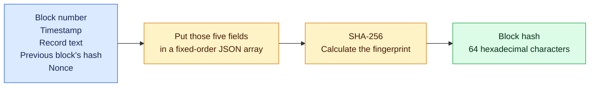
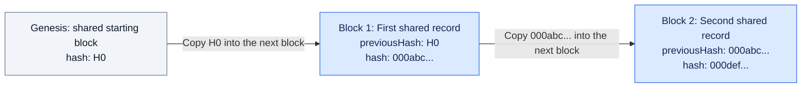
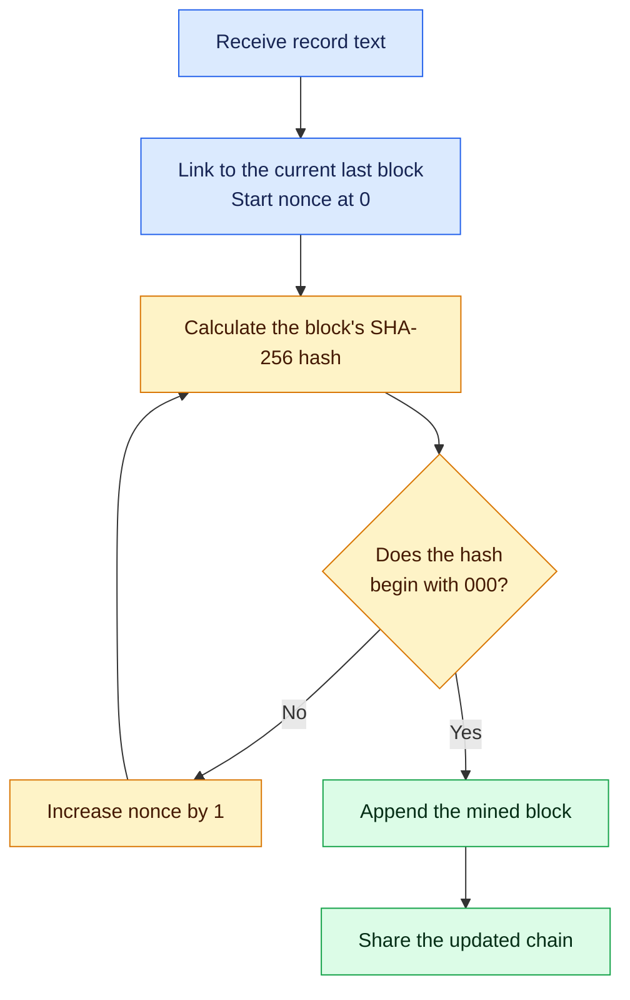
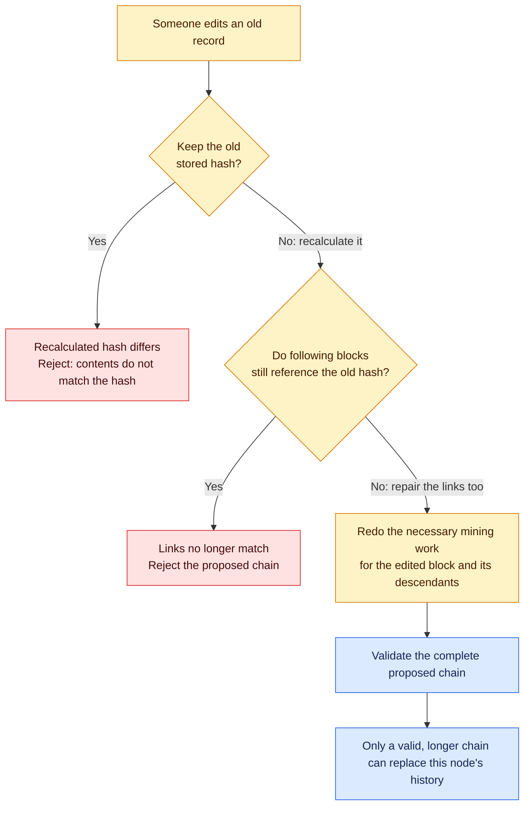
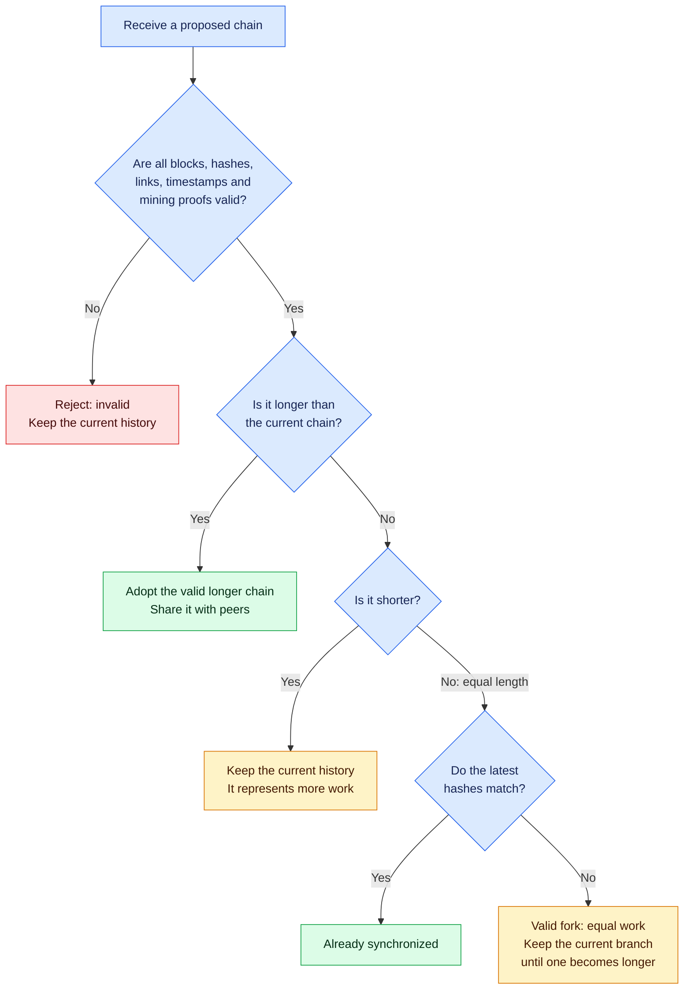
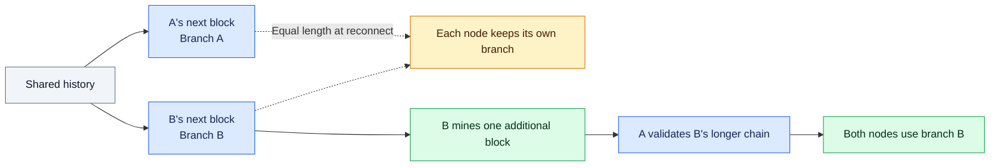

# Blockchain, visually

> Several independent participants keep copies of a shared history. Each participant checks the records, their links, and their mining work before accepting a longer history.

This walkthrough follows the implementation in [`src/server.js`](../src/server.js) and [`src/client.js`](../src/client.js). Read the diagrams from top to bottom when presenting to someone new. Hashes shown with `...` are shortened, illustrative examples.

## 1. A hash is a block's fingerprint

The same inputs always produce the same fingerprint. Changing any input changes the fingerprint. The block stores the result so another participant can calculate it again and check that it matches.



**Say:** "A hash lets every participant independently check the fingerprint of a record."

## 2. The fingerprints connect the history

Each new block contains the previous block's hash. The arrows show the order of the records; the labels show which fingerprint the next block stores.



The genesis block is identical on every node and is exempt from mining. Every later block must satisfy the mining requirement.

**Say:** "Each block carries a reference to the history before it. That is what makes this a chain."

## 3. Mining searches for a qualifying fingerprint

The nonce is a number the miner can change. At difficulty **3**, a mined hash must begin with **`000`**. Each attempt recalculates the entire hash with a different nonce.



There are 16 hexadecimal digits, so three leading zeroes take about **16 x 16 x 16 = 4,096 attempts on average**. The actual number varies. Another participant can verify the winning hash with one calculation.

This diagram shows a successful mining job. The server also checks input and chain limits, allows one job per node, and discards stale work if the chain changes during mining.

**Say:** "Finding a qualifying fingerprint takes work. Checking the answer is quick."

## 4. Two independent nodes synchronize

`127.0.0.1` means this computer. Ports `3000` and `3001` let two independent node processes run on the same laptop. Node B's `PEERS` setting tells it to connect to A. That socket connection carries messages in both directions.


Either node can mine. On reconnect, B offers its current chain again, including any blocks mined while disconnected. Progress events are available for visualizers; the terminal client displays chain summaries and mining completion, with full block details available through `view`.

**Say:** "The second participant checks the history for itself before adopting it."

## 5. Changing an old record leaves evidence

Validation recalculates each hash, checks the links and timestamps, and verifies proof of work. A proposal must pass all checks before its length matters.



A fully re-mined alternative history can be accepted if it is valid and longer. The rules establish consistency and work; they cannot establish whether arbitrary record text is true or authorize a payment.

**Say:** "Changing an old record means dealing with its fingerprint, every later link, and the mining requirements."

## 6. Validation comes before choosing a history

Difficulty is fixed across the network, so a longer valid chain represents more work. A chain with more blocks still has to pass every validation check.



**Say:** "A longer history wins only after every block passes validation."

## 7. A fork resolves when one valid branch grows

Two participants can mine different valid blocks while disconnected. When they reconnect with equal-length histories, each keeps its branch. In the automated demo, B then mines one more block and A adopts B's longer valid branch.



**Say:** "A temporary disagreement can happen between honest participants. One additional valid block resolves this fork."

## Show it running

From the project folder, with Node.js 20 or later:

```bash
npm install
npm run demo
```

The four `PASS` messages demonstrate synchronization, rejection of a longer fabricated chain, an equal-work fork, and resolution after one branch grows. To show the additional validation and networking checks, run:

```bash
npm test
```

The project stores text records in memory. Restarting a node resets its history. The terminal client and socket API are implemented; a browser visualizer can connect through that API.
